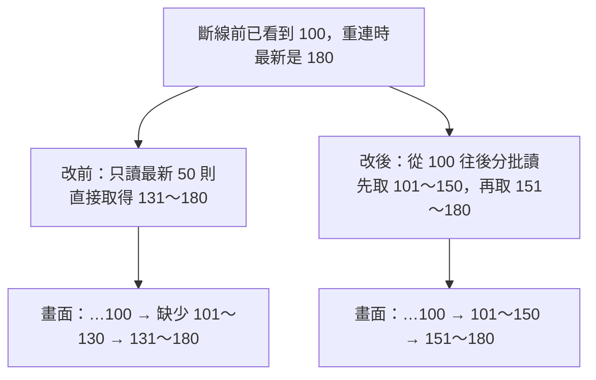
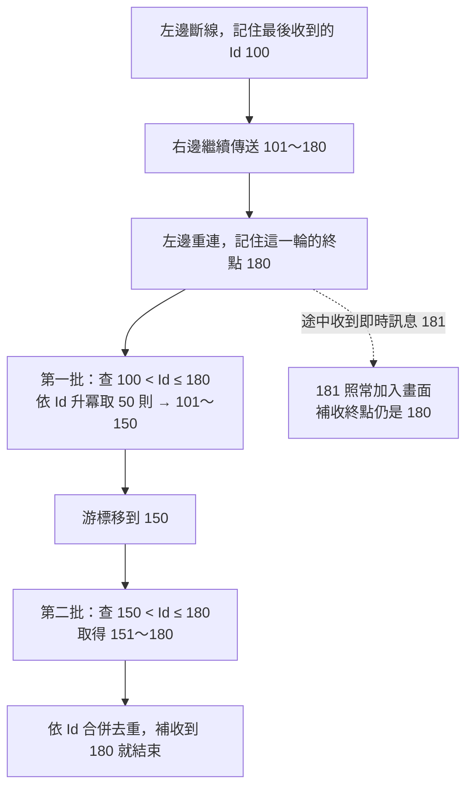

# 第二十六課：聊天室斷線後分批補收

假設斷線前最後一則是 100，重連時最新一則是 180。從後端取回 101～150、151～180 兩批，各批最多 50 則。補收期間若收到 181 的即時廣播，仍會依原來的範圍繼續查到 180。

## 改前與改後

以下假設這段期間的訊息 Id 連號。兩種做法都是每次最多取 50 則，差別在查詢的起點。

## 改後的補收流程

1. [ChatPanel.vue](../frontend/src/components/ChatPanel.vue) 在斷線時記下目前最大的 Id。`GetRecentMessages()` 提供重連當下的最新 Id，作為本輪補收終點。
2. [ChatHub.cs](../Hubs/ChatHub.cs) 的 `GetNewerMessages` 用 `afterId < Id <= throughId` 篩選，依 Id 升冪取 50 則。這次需要先拿到最接近斷線前游標的資料，所以不必反轉結果。
3. [chatHistory.ts](../frontend/src/services/chatHistory.ts) 用每批最後一則的 Id 推進游標。Vue 用既有的 Id 去重、排序與捲動規則更新畫面。若補收失敗，可重新連線從保留的起點重試。

Laravel Query Builder 的對照寫法是 `where('id', '>', $afterId)->where('id', '<=', $throughId)->orderBy('id')->limit(50)`。

整合測試讓其中一條連線離線，另一條送出 51 則。重連後驗證分成 50 則與 1 則，順序與內容都一致，並另外送一則訊息驗證補收範圍有固定終點。

游標僅保留在當前頁面，刷新或離開聊天室會重新載入最新 50 則。Id 有空號也可正常分頁。若較小的 Id 在較大的 Id 之後才提交，而它的廣播也在斷線時錯過，這種 Id 游標可能漏掉它。若需要嚴格的投遞保證，要改用依提交順序可重播的事件紀錄。
