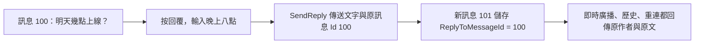

# 第二十七課：回覆指定訊息

按訊息旁的「回覆」，輸入框上方就會顯示引用預覽。「取消回覆」會保留已輸入的文字。送出後，聊天室會在回覆正文上方顯示原作者與原文。

[資料庫模型](../Models/ChatMessage.cs)只存原訊息的 Id。一般訊息的 `ReplyToMessageId` 為 `null`，而回覆的外鍵指向同一張 `chat_messages` 表。這是自我關聯。原訊息刪除後，回覆的引用框會顯示「原訊息已刪除」。

[ChatHub](../Hubs/ChatHub.cs) 先確認原訊息存在，再儲存回覆。查詢先篩選、排序和取分頁，再用共用的 `Select(ToResponse)` 組出包含引用的回應。即使畫面還沒載入原訊息，也能顯示一層引用。Laravel Eloquent 可用 `belongsTo(self::class, 'reply_to_message_id')` 表達相近的關聯。

可開兩個聊天室分頁，在左邊回覆一則訊息，確認右邊收到的引用包含原作者和原文。再重新整理右邊，確認查詢歷史後依然顯示。整合測試會檢查無效引用、即時廣播、歷史分頁與重連補收。
