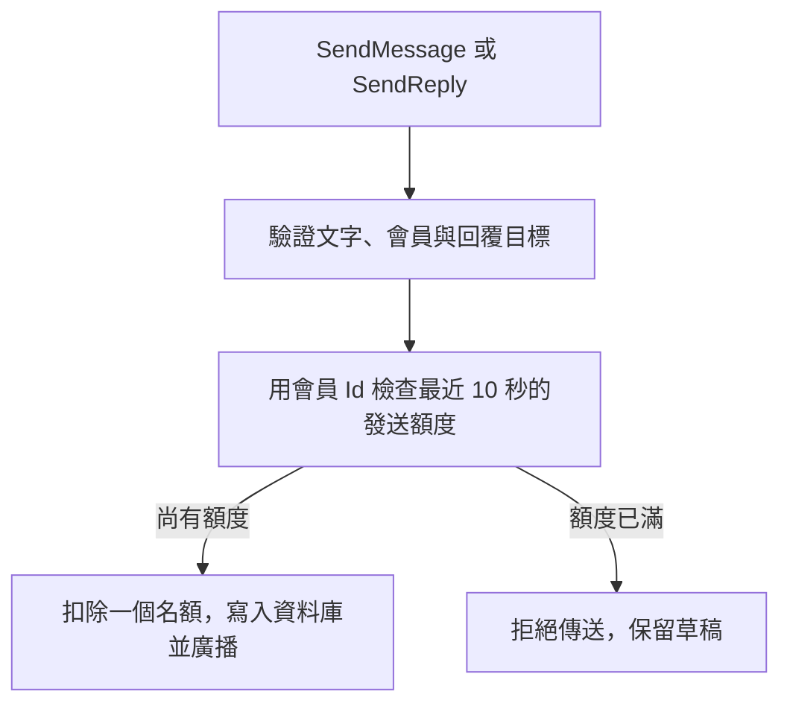

# 第二十八課：聊天室發送限流

同一會員在最近 10 秒內最多送 5 則。一般訊息與回覆共用額度，同一帳號開兩個分頁也共用。超過額度時會提示「傳送太頻繁，請稍後再試」，並保留輸入文字與引用選擇。

[ChatHub](../Hubs/ChatHub.cs) 把兩種發送都交給 `SaveAndBroadcastAsync()`。通過驗證才扣額，超過額度的請求會在寫入前被拒絕。若取得額度後資料庫寫入失敗，該名額仍會在 10 秒後恢復。

[ChatSendLimiter](../Services/ChatSendLimiter.cs) 每次檢查時先移除已滿 10 秒的紀錄，每則訊息各自到期。例如前五則是第 0、1、2、3、4 秒送的，到第 10 秒會先釋放第 0 秒的名額。這叫滑動視窗。`lock` 把檢查和扣額一起執行，避免兩個分頁同時拿到最後一個名額。Laravel 的 `RateLimiter` 和 Go 的 `sync.Mutex` 分別可用來理解「限制頻率」與「一次只讓一個工作修改額度」。

[Program.cs](../Program.cs) 用 `AddSingleton` 讓同一個後端程序的所有連線共用限流器。額度存在記憶體中，重啟會重設。多個後端副本若要共用額度，需要共用的計數儲存。

可在兩個分頁登入同一會員，在 10 秒內交替送出一般訊息與回覆，確認第 6 則被拒絕，文字仍在輸入框中。等最早一則超過 10 秒後再送，就會有可用名額。整合測試也會檢查另一會員可以照常發送，以及被拒絕的內容沒有寫入或廣播。
