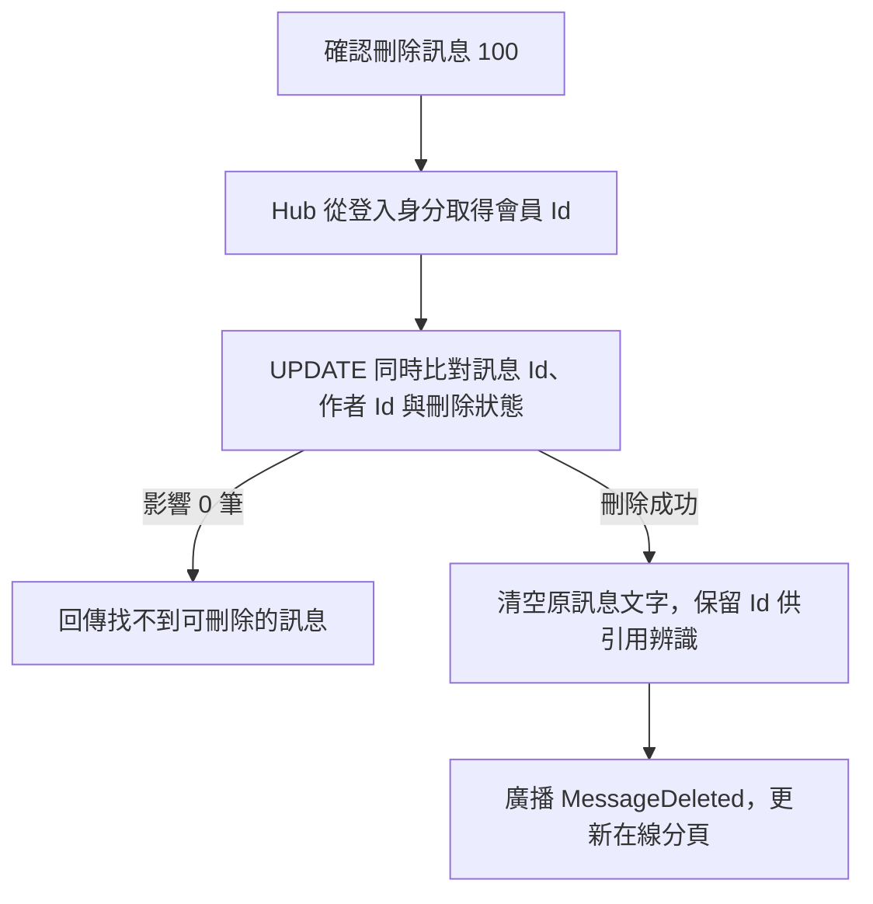

# 第二十九課：刪除自己的聊天室訊息

自己發出的訊息靠右、用紫色訊息框凸顯，作者旁標示「你」。其他會員的訊息靠左。訊息作者可以按「刪除」，再按「確認刪除」。其他在線分頁會收到通知並移除該訊息。如果原訊息被引用，回覆正文會留在清單，引用框改顯示「原訊息已刪除」。

[ChatHub](../Hubs/ChatHub.cs) 用 `ExecuteUpdateAsync()` 把擁有權檢查與刪除狀態更新放在同一條 SQL。Laravel Query Builder 也能用 `where()` 加上 `update()` 做條件式更新。

資料庫保留其他回覆的 `ReplyToMessageId`，讓重新載入的頁面能辨識已刪除的原訊息。前端記住收到的刪除 Id，即時換掉引用內容，也能遮蔽較晚抵達的舊原文。舊版的實體刪除已清空引用關聯，因此這些回覆無法補上提示。

在線分頁靠廣播立即更新。離線分頁會在[重連時核對已載入的訊息與引用](30-chat-reconnect-deletions.md)。
