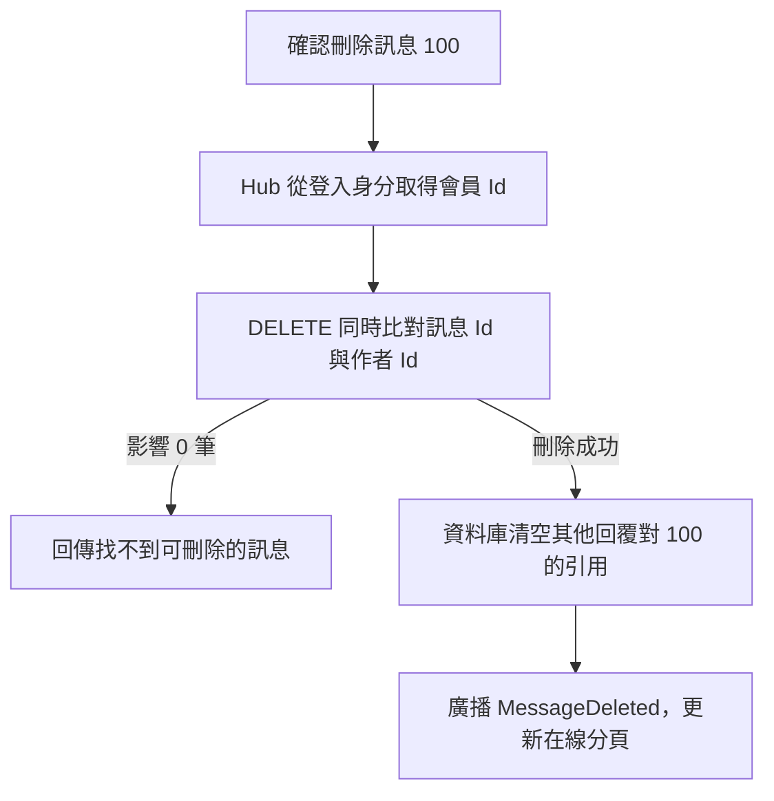

# 第二十九課：刪除自己的聊天室訊息

自己發出的訊息靠右、用紫色訊息框凸顯，作者旁標示「你」。其他會員的訊息靠左。訊息作者可以按「刪除」，再按「確認刪除」。其他在線分頁會收到通知並移除該訊息。如果原訊息被引用，回覆正文會留在清單，只移除引用區塊。

[ChatHub](../Hubs/ChatHub.cs) 把擁有權檢查放進 `ExecuteDeleteAsync()` 的條件。只知道訊息 Id 也無法刪除別人的訊息。查不到與不屬於自己都回傳相同錯誤。Laravel Query Builder 可以用兩個 `where()` 加上 `delete()` 做同樣的條件式刪除。

既有的 `ON DELETE SET NULL` 會清空指向原訊息的 `ReplyToMessageId`。前端收到刪除事件也會清除目前畫面的引用、未讀提示與回覆選擇，並記住該 Id，避免較晚抵達的歷史回應把它加回來。

第一版同步在線分頁。若某分頁在離線期間錯過刪除事件，重連補收仍只查新增訊息。重新整理後，最新一頁會反映資料庫的刪除結果。
