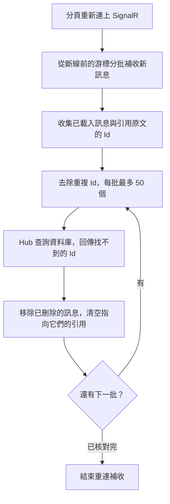

# 第三十課：重連後清除已刪除的訊息與引用

SignalR 的 `MessageDeleted` 會通知在線分頁。分頁離線時如果漏掉通知，前端會在重連補收新訊息後，把目前已載入的訊息 Id 和引用原文的 Id 送回後端核對。

## 用一則回覆理解

假設第 120 則訊息引用第 70 則，而畫面只載入了第 120 則。即使第 70 則不在訊息清單裡，它的文字仍出現在引用區塊，因此前端得同時查 120 和 70。如果後端只回傳 70，畫面會保留第 120 則的正文，並移除引用。

## 程式碼閱讀順序

1. [ChatPanel.vue](../frontend/src/components/ChatPanel.vue) 的 `loadHistory` 先補收，再核對已載入的資料。`olderBeforeId` 保存查到的最舊 Id，即使該則訊息被移除也能用它繼續往前翻頁。
2. [chatHistory.ts](../frontend/src/services/chatHistory.ts) 的 `syncChatDeletions` 用 `Set` 去重後分批。每批回來都確認這輪重連仍有效，才把結果交給畫面。
3. [ChatHub.cs](../Hubs/ChatHub.cs) 的 `GetMissingMessageIds` 只讀取資料庫還存在的 Id，再用 `Except` 算出差集。以 Laravel Query Builder 類比，可以用 `whereIn('id', $ids)->pluck('id')` 取得仍存在的 Id，再用 `array_diff` 求差集。

## 手動驗證

1. 用兩個獨立的登入環境以不同帳號開啟聊天室。分頁 A 發一則測試訊息，分頁 B 引用它並傳送回覆。
2. 在分頁 B 的開發者工具切換成離線，保留當前畫面。等聊天室顯示斷線或正在重連後，在分頁 A 刪除原訊息。
3. 將分頁 B 切回連線，若自動重連已停止就按「重新連線」。確認 B 的原訊息和引用都消失，回覆正文仍在。
