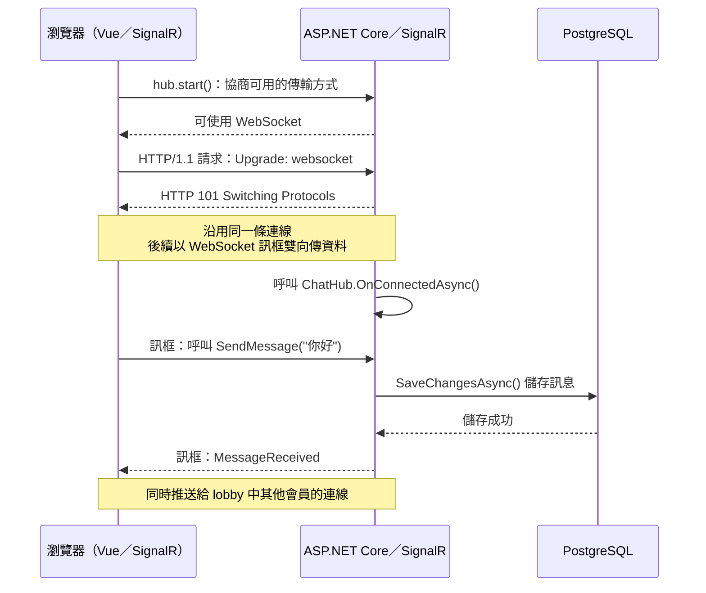

# WebSocket 與 SignalR：從連線到即時更新

這張圖以本專案的 Vue 會員聊天室為例。**WebSocket 負責維持雙向傳輸通道；SignalR 負責把收到的資料對應到 Hub 方法，並將結果送給指定連線。**

## 讀圖重點

1. `hub.start()` 由 SignalR Client 發起。一般情況下，先協商傳輸方式，再建立連線。圖中的 `Upgrade` 與 `101` 描述 **HTTP/1.1** 的 WebSocket 握手；使用其他 HTTP 版本時，建立方式可能不同。
2. 握手完成後，雙方在持續開啟的連線上交換 WebSocket **訊框（frame）**。訊框可以裝文字或二進位資料；Ping、Pong、Close 則是控制訊框。伺服器因此能主動傳送新訊息，無須等瀏覽器再次查詢。
3. SignalR 在 WebSocket 上傳送自己的 Hub 訊息。瀏覽器的 `connection.invoke('SendMessage', ...)` 會呼叫 `ChatHub.SendMessage`；後端儲存成功後，`Clients.Group(...).SendAsync('MessageReceived', ...)` 會通知群組，瀏覽器的 `hub.on('MessageReceived', ...)` 接收並更新 Vue 畫面。
4. `OnConnectedAsync()` 是 SignalR 在連線建立後呼叫的生命週期方法。聊天室把連線加入 `lobby`；TodoHub 則把連線加入該會員自己的群組。網路中斷後，Client 會嘗試重新連線；聊天室成功重連時會補讀最近 50 則訊息。

WebSocket 是傳輸層；資料庫不會自行把變更推到瀏覽器。本專案在完成資料庫寫入後，才由程式透過 SignalR 推送事件。

參考：[WebSocket 協定 RFC 6455](https://www.rfc-editor.org/rfc/rfc6455.html)、[ASP.NET Core SignalR 概覽](https://learn.microsoft.com/en-us/aspnet/core/signalr/introduction?view=aspnetcore-10.0)。
